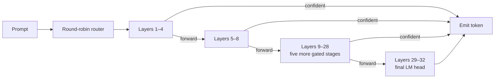

# EE-LLM

### Confidence-gated early-exit inference for Llama 3.1 8B

EE-LLM is a research prototype that asks a practical systems question: **can an
LLM stop computing once it is already confident about the next token?** It
splits a frozen Llama 3.1 8B backbone into eight four-layer stages and attaches
small, distillation-trained exit heads at layers 4–28. A local forwarder uses
calibrated logit, margin, and entropy gates to either emit a token or route the
hidden state to the next stage.

The project spans the full ML-systems workflow: dataset preparation,
knowledge-distillation training, threshold calibration, artifact export,
multi-GPU segmented inference, and benchmark aggregation.

> **Project status:** research prototype. The lightweight pipeline and training
> utilities are unit tested; full experiments require gated access to the Llama
> 3.1 8B weights and CUDA hardware. Benchmark claims should be treated as
> experimental until reproduced from the documented workflow.

## Why it is interesting

- **Fine-grained adaptive compute.** Seven exits provide more choices than a
  shallow/deep two-model cascade.
- **Local decisions.** Each forwarder lives beside its segment, avoiding a
  centralized activation-routing bottleneck.
- **Quality-aware gating.** An exit must pass confidence, top-two margin, and
  entropy checks—not just a single threshold.
- **Frozen-backbone training.** Knowledge distillation trains lightweight exit
  heads without updating the 8B-parameter teacher.
- **End-to-end evaluation.** The runtime records exit depth and latency alongside
  task metrics to expose the quality/compute trade-off.

## Architecture



At each intermediate stage, the exit decision is:

```text
top_logit >= logit_threshold
and top1_minus_top2 >= margin_gate
and entropy <= entropy_gate
```

See [guidance.md](guidance.md) for the research motivation and
[training/docs/workflow.md](training/docs/workflow.md) for the experiment flow.

## Repository map

| Path | Purpose |
| --- | --- |
| `runtime/` | Segment workers, routing, confidence gates, and autoregressive inference |
| `training/` | Distillation, calibration, checkpointing, export, and SLURM jobs |
| `evaluation/` | Benchmark loading, scoring, latency, and exit-depth metrics |
| `config/` | Model topology, runtime placement, and calibrated thresholds |
| `scripts/` | Reproducible inference, aggregation, and plotting commands |
| `tests/` | Fast tests for gating, routing, checkpointing, and batching |

Generated datasets, model artifacts, checkpoints, credentials, and run logs are
intentionally excluded from version control.

## Quick start

Python 3.10+ is recommended.

```bash
git clone <your-repository-url>
cd eellm
python3 -m venv .venv
source .venv/bin/activate
python -m pip install --upgrade pip
python -m pip install -r training/requirements.txt
pytest -q
```

The tests use small synthetic modules and do not download Llama weights.

## Reproduce the training workflow

1. Request access to `meta-llama/Llama-3.1-8B-Instruct` and authenticate with
   Hugging Face locally.
2. Download and tokenize a dataset using the scripts in `training/scripts/`.
3. Run a short smoke training job before scheduling a full GPU run.

```bash
python -m training.main \
  --manifest config/manifest.json \
  --dataset data/training/dataset_subset.jsonl \
  --output-dir artifacts/exit-heads-smoke \
  --checkpoints checkpoints/exit-heads-smoke \
  --calibration-path data/training/calibration_subset.jsonl \
  --thresholds-output artifacts/exit-heads-smoke/thresholds.json \
  --device cuda \
  --batch-size 1 \
  --max-steps 20
```

For dataset preparation, resume behavior, artifact layout, and HPC submission,
follow [training/docs/getting_started.md](training/docs/getting_started.md).

## Build the lightweight pipeline

```python
from pathlib import Path

from config.loader import load_manifest, load_thresholds
from runtime import RuntimeFactories, build_segmented_pipeline

manifest = load_manifest(Path("config/manifest.json"))
thresholds = load_thresholds(Path("config/thresholds.json"))
pipeline = build_segmented_pipeline(manifest, thresholds, RuntimeFactories())

result = pipeline.run([2.0, 1.8, 1.6])
print(result["exit_segment"])
```

This path demonstrates orchestration with the repository's compact test
artifacts. The native autoregressive path in `runtime/autoregressive.py` loads
the exported backbone and exit heads for real model inference.

## Evaluation

The evaluation layer supports IFEval, AlpacaEval 2, GSM8K, and an English MMLU
subset. A useful experiment should report at least:

- task accuracy or instruction compliance;
- average and distribution of exit depth;
- median and P95 end-to-end latency;
- hardware, precision, batch size, prompt length, and generation length;
- the threshold configuration used for the run.

Raw run output belongs under `logs/` and can be summarized with
`scripts/aggregate_mmlu_results.py`. Do not commit per-request logs or model
weights; publish a small, provenance-rich summary or release artifact instead.

## Limitations

- KV caching is disabled in the current research path, so prefixes are
  recomputed during autoregressive generation.
- Confidence thresholds are model- and workload-specific and require
  calibration before comparisons are meaningful.
- Multi-GPU placement in `config/manifest.json` targets a particular
  experimental topology and should be adapted to the host.
- Early exits can trade quality for latency; a baseline using the final head is
  essential for every reported result.

## Contributing

Bug reports and focused improvements are welcome. Read
[CONTRIBUTING.md](CONTRIBUTING.md) before opening a pull request. For security
issues, follow [SECURITY.md](SECURITY.md) instead of filing a public issue.

## Acknowledgments

This project builds on PyTorch, Hugging Face Transformers and Datasets, and the
Llama 3.1 model family. Users are responsible for complying with the licenses
and terms of all models and datasets they use.

## License

The repository's original code is available under the [MIT License](LICENSE).
Third-party models and datasets remain subject to their own terms.
